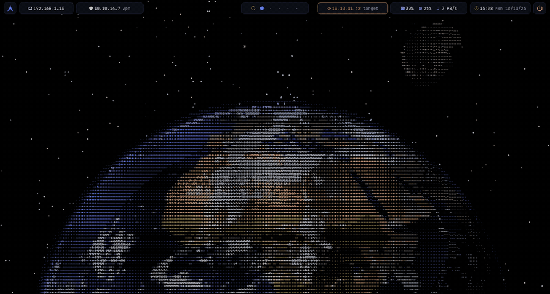
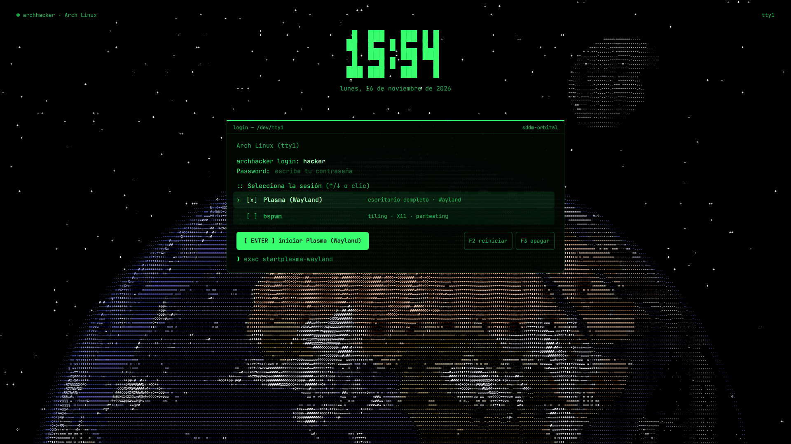
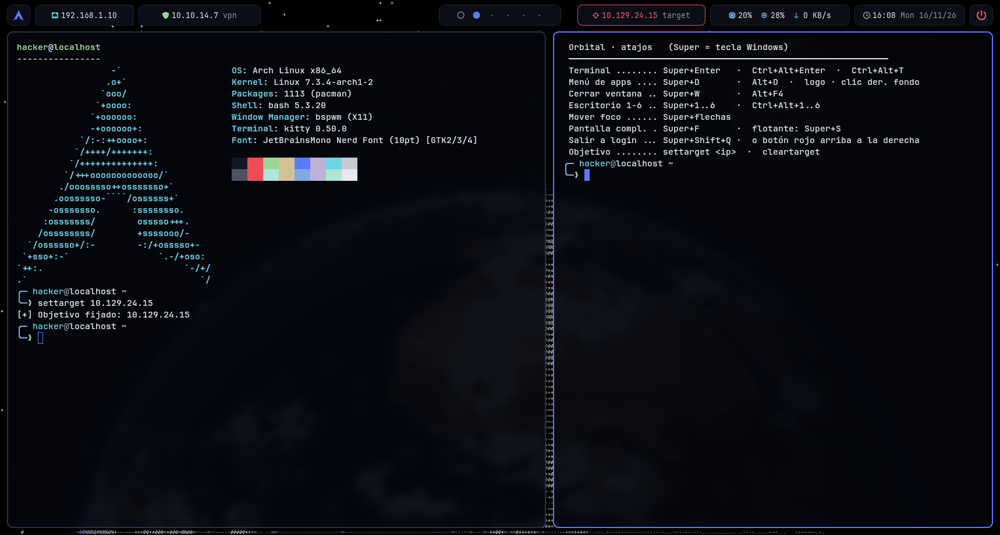
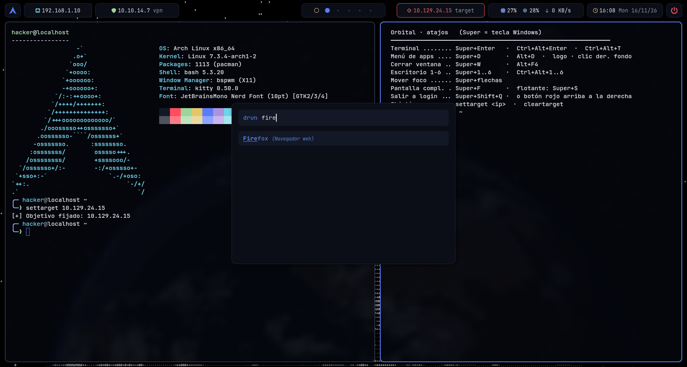
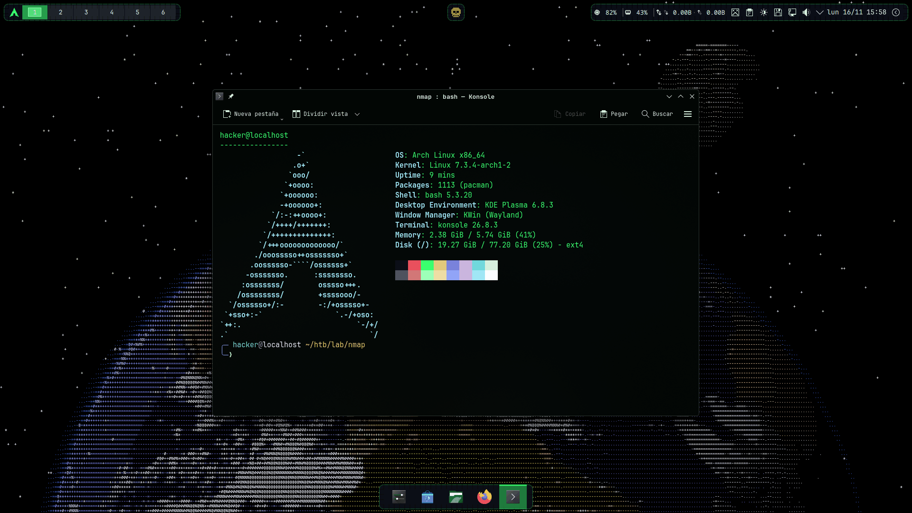

<div align="center">

# Arch-Sp4c3-0X

**Arch Linux para pentesting con dos escritorios: KDE Plasma 6 y bspwm**

Estética de terminal verde, barras en píldora y una Tierra ASCII animada de fondo.




</div>

> ⚠️ **Solo para uso autorizado**: sistemas propios, laboratorios (HackTheBox,
> TryHackMe) o pruebas con autorización por escrito.

## Qué es

Una **receta** para reconstruir un Arch Linux de laboratorio de hacking ético. No
incluye el disco de la máquina virtual: solo scripts y configuraciones, para que lo
recrees desde la ISO oficial de Arch.

- **Login (SDDM)** tipo terminal verde sobre una Tierra ASCII animada, con selector de escritorio.
- **KDE Plasma 6** con estilo *Orbital*: paneles en píldora, acentos verdes de terminal y Konsole a juego.
- **bspwm**: polybar en píldoras, kitty, rofi, fondo animado y atajos de teclado.
- **Herramientas de pentest** desde BlackArch, ordenadas por categoría en el menú.
- **Privacidad** opcional: Tor, Tor Browser, uBlock Origin y nombre de equipo que no se envía a la red.

## Capturas

### Login

Terminal verde sobre la escena Orbiter. Se elige la sesión con ↑/↓ y se entra con Enter.



### bspwm

Barra en píldoras: red, VPN, escritorios, **objetivo** (IP de la máquina víctima),
recursos, reloj y apagado. Funciones de shell para el flujo de trabajo:
`settarget`, `extractPorts`, `mkt`, `whichsystem`.

El GIF de la portada muestra la sesión en movimiento: fondo animado, terminales
en mosaico, `settarget` actualizando la barra y el menú rofi.

<table>
  <tr>
    <td></td>
    <td></td>
  </tr>
  <tr>
    <td align="center">Terminales en mosaico</td>
    <td align="center">Menú de aplicaciones (rofi)</td>
  </tr>
</table>

### KDE Plasma 6 · Orbital

Paneles flotantes en píldora con borde verde, seis escritorios, el logo de Arch y Konsole verde.



## Atajos de bspwm

| Acción | Atajo | Alternativa sin tecla Super |
|---|---|---|
| Terminal | `Super + Enter` | `Ctrl + Alt + T` |
| Menú de apps | `Super + D` | `Alt + D` · clic derecho en el fondo |
| Cerrar ventana | `Super + W` | `Alt + F4` |
| Escritorio 1–6 | `Super + 1…6` | `Ctrl + Alt + 1…6` |
| Pantalla completa / flotante | `Super + F` / `Super + S` | — |
| Salir al login | `Super + Shift + Q` | botón rojo de la barra |

Escribe `atajos` en cualquier terminal para ver la lista completa.

## Estructura

| Carpeta | Qué contiene |
|---|---|
| `scripts/arch_base_install.sh` | Instalación base desde la ISO: particiones UEFI, KDE Plasma, usuario, bootloader. **Borra el disco indicado** (pide confirmación). |
| `scripts/pentest_tools.sh`, `fix_tools.sh` | Repositorio BlackArch y herramientas por categoría. |
| `scripts/menu_setup.sh` | Menú de aplicaciones de pentest por categorías en español. |
| `scripts/privacy_setup.sh` | Tor, Tor Browser, uBlock Origin en Firefox y nombre de equipo privado. |
| `scripts/orbiter_apply.sh`, `panel.js`, … | Tema Orbiter y paneles de Plasma (scripting). |
| `widgets/` | Widgets propios de Plasma: objetivo IP y calaveras 8-bit por ventana. |
| `plasma-orbital/` | Estilo Orbital para Plasma (colores, paneles, Konsole). Ver su README. |
| `bspwm-orbital/` | Sesión bspwm + polybar + tema de login SDDM. Ver su README. |
| `docs/screenshots/` | Capturas de este README. |
| `packages-explicit.txt` | Paquetes instalados explícitamente. |

## Instalación (resumen)

1. Crea una VM UEFI (probado en VMware Workstation: 4 CPU, 6 GB RAM, 80 GB, 3D activado).
2. Arranca la ISO de Arch y ejecuta la instalación base (te pide confirmación y contraseñas):
   ```bash
   DISK=/dev/sda AH_USER=hacker AH_HOSTNAME=archhacker AH_TZ=UTC bash scripts/arch_base_install.sh
   ```
3. Reinicia y, como root: `pentest_tools.sh`, `fix_tools.sh`, `menu_setup.sh`.
4. Tema Orbiter para Plasma: `scripts/orbiter_apply.sh`.
5. Widgets: `kpackagetool6 --type Plasma/Applet --install widgets/<nombre>`.
6. Escritorio bspwm y login: [`bspwm-orbital/README.md`](bspwm-orbital/README.md).
7. Estilo Plasma Orbital: [`plasma-orbital/README.md`](plasma-orbital/README.md).
8. Privacidad (opcional): `sudo bash scripts/privacy_setup.sh localhost`.

> Las capturas usan valores de ejemplo (usuario `hacker`, IPs de laboratorio).

## Créditos

- Tema y escena **Orbiter** — [omnicons/orbital-kde-shell](https://github.com/omnicons/orbital-kde-shell) (MIT).
  Se descarga e instala desde su repositorio; aquí no se redistribuyen sus archivos.
- Texturas de la Tierra y la Luna usadas por Orbiter: NASA (dominio público).
- **kvitals** — [yassine20011/kvitals](https://github.com/yassine20011/kvitals).
- Idea del entorno bspwm: estilo popularizado por S4vitar.
- [BlackArch](https://blackarch.org) para las herramientas de pentest.

## Licencia

[MIT](LICENSE)
